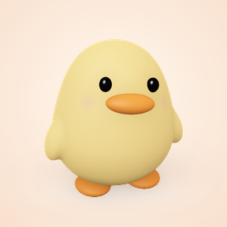

<h1 align="center">Scroll Duck 🦆</h1>

A tiny duck that lives on your phone and gently pulls you out of endless Reels &amp; Shorts.

  <a href="https://github.com/khoa-nhd/scroll-duck-app/releases/latest/download/scroll-duck.apk"><b>⬇️ Download the latest APK</b></a>
  &nbsp;·&nbsp;
  <a href="https://khoa-nhd.github.io/scroll-duck-app/">Download page &amp; guide</a>

## What does the duck do?

- ⏱️ **A daily budget**: scroll within your limit and the duck leaves you be; go over, and out it waddles onto your screen.
- ⏸️ **Pauses the video for you**: Instagram, Facebook Reels, YouTube Shorts.
- 💬 **A caring chat**: the duck checks in, listens, and remembers what you share (AI).
- 🌙 **Study and sleep time**: nudges you back to studying, and off to bed when it's late.

## Install

1. Download [`scroll-duck.apk`](https://github.com/khoa-nhd/scroll-duck-app/releases/latest/download/scroll-duck.apk) and open it.
2. If asked, allow **installing unknown apps**. If Play Protect warns you, choose *More details → Install anyway*.
3. Open the app, tap **turn me on**, and switch *Scroll Duck* on under **Accessibility**.

> **Can't switch it on?** Android 13+ restricts apps installed outside the Play Store. Go to *Settings → Apps → Scroll Duck*, tap **⋮** → **Allow restricted settings**, then try again.

> **"App not installed"?** An older Scroll Duck from somewhere else is already on the phone. Uninstall it first, then open the APK again.

Requires Android 11 or newer (the 3D duck needs Android 13+).

## Updates

The app checks for a new version when you open it. When one is out you'll see **"a new me is here! 🎁"**; tap **update me** and you're done. Your settings and memories stay.

## Privacy

The duck only looks at screen IDs to tell when you're on Reels or Shorts, never at the text or content on your screen. Only what you type or say in the chat is sent to the AI so it can reply.

---

This repo only hosts the app downloads (the source code is not public). Found a bug or have an idea? Open an [issue](https://github.com/khoa-nhd/scroll-duck-app/issues).
